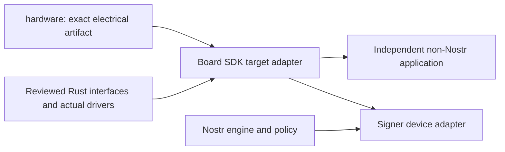

# Board SDK service and dependency decisions

Documentary candidate, 20 October 2026. This implements only the scope admitted
in [preparation-acceptance.json](preparation-acceptance.json). No SDK crate,
driver, dependency, board tuple or production interface is selected or released.
The exact source/version and claim locators are in
[source-register.json](source-register.json). `SDK-*` requirements are defined by
the accepted [brief](brief.md); lifecycle rules are in [lifecycle.md](lifecycle.md).

## Dependency direction and useful consumers

An application owns its meaning and authorization. Board SDK supplies bounded
device services to one trusted firmware image. A Nostr Signer may eventually
consume them; an independently built display/input diagnostic and a generic
key-operation demonstration are the B02/B03 non-Nostr consumer candidates.
Neither consumer is implemented or qualified here. An SSH/FIDO/wallet firmware
needs its own application protocol, security and interoperability acceptance.

Arrows mean supplies an input/service, not a reverse code dependency. Board SDK
must not import the Nostr engine, event schemas, account/session rules, Bridge or
TypeScript integration SDK. `board-sdk` is the repository name; `@nsealr/sdk`
names a different host package. One-image linkage and Rust borrowing provide no
isolation from malicious firmware, raw peripheral access or a replacement image.
Do not introduce a plugin manager, task service or a universal HAL.

The build consumes an immutable hardware artifact and exact reviewed driver
resolution, not `../hardware` or `../nsealr`. Release evidence records registry
checksums or immutable Git revisions, Cargo.lock, feature unification, target,
toolchain and image/map hashes. A library's compatible version requirement is
not the resolved release dependency closure. Unknown features/tuples reject;
no default selects an experimental board. B02 must first admit the actual
consumer, writable crate scope and target before any executable extraction.

## Common operation contract

These are requirements on future selected adapters, not existing guarantees of
the surveyed traits. Numerical bounds are **pending target configuration and
measurement**. An adapter is unsupported until its required bounds and fault
behavior are supplied; the word "bounded" is not a default value.

- Pin per-operation maximum bytes/items, allocations, queued operations,
  transfers/retries, elapsed time, cleanup time, and retained state. Check lengths,
  address ranges and arithmetic before effects. Initial embedded adapters use
  caller-owned fixed-capacity storage; no unbounded allocation or retry loop.
- Pin the clock/watchdog source, wrap/reset behavior and whether the driver can
  block or mask interrupts. An executor timeout cannot bound a blocking poll or
  an uninterruptible DMA operation. A supported target needs measured normal,
  fault and terminal reset/recovery bounds, including failed cleanup.
- Bind buffer regions, DMA/master ownership, cache coherency and security
  attribution to the selected target. Cache invalidation is not secret erasure.
  Recovery/watchdog feeding needs an identified progress-qualified owner;
  an interrupt that keeps reloading a watchdog during a stalled operation does
  not establish a terminal recovery bound. Validate input mode/reader attribution
  before interpreting a returned bit as a physical control state.
- Distinguish validation rejection, unavailable/not-ready, busy, timeout,
  interrupted, provider/bus fault, health failure, corrupt/rollback state,
  unsupported tuple/algorithm, stale/foreign handle and unknown durable outcome.
  Do not flatten them to success or retry every error. Diagnostics contain
  operation classes and bounded public metadata, never secrets/PINs/pixels.
- The service owns its peripheral, staging buffers, interrupts/DMA descriptors
  and partial result until quiescence. Cancellation invalidates the operation
  and its generation before any later completion can publish a result. Do not
  return/reuse borrowed memory while hardware can still access it; then clear
  owned sensitive scratch and release resources. If safe quiescence is not
  established, poison the service and take its documented fail-closed reset or
  recovery path. A future's `Drop` alone proves neither cleanup nor rollback.
- An error does not undo an already-sent command, emitted byte or persistent
  mutation. Report side effects/durable uncertainty and reconcile before reuse.
  Automatic replay of signing, counters, owner updates or erase is forbidden
  without an accepted idempotence/recovery argument. No failed/partial crypto
  result becomes eligible for transport after a retry or reset.
- Local handle/epoch invalidation does not revoke an SE's surviving authenticated
  session. A credential update/delete or lost response is not assumed to close
  it. The exact backend must prove explicit session termination, reauthentication
  or reset before reuse; otherwise remain unavailable. Process-local handles
  are not a wire/serialized object-ID format. Reopening a persistent object must
  repeat its current authority and tuple checks, not restore an old handle.

## Services, ownership and qualification

Operation names below describe responsibilities, not exported Rust signatures.
Each selected adapter must implement the common bounds as well as its row.
Application-level consent, transaction review and protocol correlation stay in
the application; generic input/display/key services cannot mint that authority.

| Service / real future caller | Owned input/output and completion | Required limits, failure and retained state | Implementation and proof owner |
| --- | --- | --- | --- |
| Bus / selected panel, SE or expansion driver | Board initialization owns pins, clocks and private peripherals. A device driver receives its specific SPI device or I2C access; borrowed buffers return only after their hardware access ends. Completion distinguishes queued data from bus idle and device-command completion. | Pin mode/frequency/voltage, address/CS, word count, transaction/lock wait, retry and recovery bounds. Bus error can follow partial device effects; flush/deassert can fail. Poison/recover an uncertain bus. Private SE/review buses cannot be unrestricted expansion handles. | H01/H04 electrical/master/reset ownership; B02 exact HAL/driver and bus fault traces; B03 assembly proof. |
| Power / initialization and lifecycle coordinator | Own rail/reset/backlight controls; request state change with exact affected domains, and return only its stated completion level. | Pin startup/settling, brownout, current, off-state leakage and unpowered-I/O limits. Failed transitions invalidate dependent operations/handles. Power-off is not proof of SE reset, erase, USB detach or removal of externally supplied power. Retained flash/SE/vendor roots remain inventoried. | H01/H04 circuit and sequencing; H02S/S04 custody dependencies; B02/B03 measured behavior. |
| Entropy / generic key generation or crypto adapter | Caller owns the fixed-capacity secret destination. Fallible all-or-error fill: accept only complete success; every returned error clears the **whole** destination and yields no secret/nonce/signature/ciphertext. | Pin provider, readiness, fill length, waits, retries, health/reset/reseed and purpose. Quiesce any writer before clearing/returning the buffer. Unbounded cleanup cannot be hidden as an error; unsupported cleanup requires fail-closed terminal recovery. No cached/deterministic/weak fallback or panic adapter. Retain no previous bytes for reuse. | S02 source-to-device requirements; B02/B03 exact linked/invoked provider and injected faults. |
| Key handle / generic key-operation application | Opaque provider-local reference binds board/provider, object, exact algorithm/parameters/purpose and lifetime/owner/session generation. Input/output buffers are caller-owned; provider retains only declared key/object/session state. | Reject foreign, stale, revoked and wrong-purpose references before use; invalidate on applicable reset/owner/session change and counter exhaustion. Pin command size/time, retries and persistent side effects. A handle is not a raw scalar, human consent, nonexportability or native BIP340. Software scalar export is a distinct explicit operation if ever admitted. | S04/H02S concrete primitives, original recovery representation and authority; B02 driver; B03 actual lifecycle evidence. |
| Storage / settings and lifecycle journal | Own a defined flash/SE namespace and staging. Read validates length/version/integrity before release. Write reports proven committed, proven not committed, or unknown durable outcome. | Pin record/erase geometry, transaction space, endurance, timeout, crash ordering and recovery bound. Reconcile unknown outcome before another mutation. Integrity/AEAD is not antirollback; acknowledged write is not physical durable completion without target proof. Delete is not physical erase or destruction of all wrapping keys. | S04 exact object/PIN/reset protocol; H01/H04 storage/reset circuit; B02/B03 torn-write and rollback proof. |
| Display / generic UI renderer | Own exact panel/controller, transport and bounded pixel/region buffers. Separate drawing in RAM, transport completion, controller acceptance and visible refresh; expose only levels the actual driver can establish. | Validate geometry/overflow and maximum pixels/transfers; do not accept an arbitrary potentially infinite iterator at the bounded security boundary. Pin color/orientation/reset/refresh/retention and DMA/cache ownership. Error invalidates the presentation epoch; old pixels may remain, so an application cannot authorize against an incomplete presentation. No photon/readability proof follows from `Ok`, buffer hash or bus flush. | H01/H04 panel, supply, connector and bus ownership; B02 actual driver; application review flow plus B03 physical visibility. |
| Input / generic UI event loop | Own exact local controls and monotonic event/sequence time. Deliver bounded typed press/release/fault events; caller never injects transport-originated approval as local input. | Pin sampling/debounce/queue/hold/time bounds, boot-held control rules and overflow behavior. Lost/stuck/ambiguous event invalidates the current gesture; reset requires observed safe release/rearm. No queue replay across presentation/session epochs. A button event alone grants no policy permission. | H01 electrical/boot/interrupt behavior; B02 target traces; application owns gesture semantics; B03 physical correlation. |
| Lifecycle / image entry, owner and recovery tools | Own admission of initialization/update/reset operations, generation invalidation and durable transition journal. Return phase/outcome, not a global `secure=true`. | Bind exact firmware/hardware/owner state and affected persistent objects; stop new work and revoke in-flight results before transition. Explicitly report interruption, remaining privileges, exhausted objects and unsupported recovery. No generic wipe/owner-transfer command is selected. | [lifecycle.md](lifecycle.md), S04/H01 concrete transitions; B02 implementation and fault proof; B03 release evidence. |

## Existing implementations: retain rather than fabricate extraction

The following source dispositions refer to the exact `f2ef70f` inputs in the
register. No source is moved by this decision.

| Candidate source | Actual behavior / generic consumer assessment | Decision |
| --- | --- | --- |
| `crates/nsealr-core/src/nip19.rs` / `SecretKey` | Owns an exportable secp256k1 scalar, validates/imports and encodes Nostr keys; wipes its current array/input on documented paths. It does not represent an SE-resident object. | Retain in Nostr engine. Do not alias it as a generic key handle or silently normalize imported private identity. |
| `session/keyring.rs` | Stores Nostr/raw-key/BIP39 session sources and labels with fixed capacities and wipe paths. The scope is an application keyring. | Retain with application/session semantics; no generic consumer justifies moving the module. |
| `review/buttons.rs`, `review/display.rs` | Their controls/pages are tied to Signer review and application decisions. | Retain in engine. Future SDK input/display adapters supply local events/transfer services without copying policy or page content. |
| Core fixed buffers, wiping and fallible entropy requirements | Fixed capacity and secret cleanup are useful requirements, but this audit has not selected a standalone generic implementation/consumer for extraction. S02 has no production entropy provider. | Reuse reviewed upstream primitives where appropriate in the later actual consumer; no duplicate crypto, empty utility crate or invented extraction now. Preserve S02 requirements as requirements. |

## Upstream interface comparison

All six versions below are inspected source snapshots, **not selected
dependencies** and not claims about the latest release. Full archive checksums,
VCS correspondence, license files and exact feature definitions are in the
register. Existing failures and corrected rand_core source-origin metadata are
retained there. No package was installed, built or executed for this document.

| Surveyed source | Useful interface / actual limitation | Decision for later concrete consumer |
| --- | --- | --- |
| `embedded-hal 1.0.0` | Reusable digital/I2C/SPI/delay interfaces. `SpiBus` may finish before idle; `SpiDevice` transaction flushes/handles CS, but lock behavior is implementation-defined and error deassertion is an attempt. I2C has a bus-idle completion requirement. `DelayNs` specifies a minimum wait, not a maximum. | Prefer compatible established traits over reproducing them. Selected driver still needs bounded lock/poll/cleanup and exact electrical evidence. No HAL crate is chosen. |
| `embedded-hal-async 1.0.0` | Async bus variants share the transaction/error vocabulary; the inspected SPI contract supplies no universal cancellation guarantee. | Async is optional only if a real caller needs it and exact future/DMA/drop recovery is proved. Do not add an executor or duplicate sync/async layers by default. |
| `embedded-io 0.7.1`, `embedded-io-async 0.7.0` | Suitable byte-stream interfaces, not atomic framed requests. Async read/write cancellation safety is encouraged, not required; `read_exact`/`write_all` can progress partially before cancellation. | Use only for actual stream transport consumers. Frame/correlation/state recovery belongs above the stream; never replay a side-effecting command because a compound helper was cancelled. |
| `rand_core 0.10.1` | `TryRng` carries errors. `TryCryptoRng` is a review marker, not source suitability/health/cleanup proof. `UnwrapErr` panics on source error and does not meet the required fallible path. | A future admitted adapter may bridge its actual fallible source; neither a trait marker nor a panic conversion qualifies it. Preserve complete-destination clearing and actual provider proof. |
| `embedded-graphics-core 0.4.0` | `DrawTarget` defines rendering and an associated error; a RAM framebuffer may use an infallible error type. `draw_iter` accepts arbitrary iterators. It has no panel flush/visible-refresh/maximum-work contract. | Possible rendering interface behind a bounded target adapter, never proof of physical presentation or trusted display. No panel, controller or display driver is selected. |

An actual adoption must recheck the resolved version/features and license closure
for the accepted consumer. Current inspected optional logging/alloc/std/math
features are not enabled by this document. Redaction obligations apply even if
a dependency offers `Debug`/logging support. No extra cryptographic implementation
is introduced to adapt an upstream interface.

Trait versions are part of that resolution: a surveyed `rand_core` interface
cannot be assumed interchangeable with a crypto consumer's different version.
Do not erase fallible entropy errors or add duplicate RNG layers to satisfy a
trait bound. The published graphics-core archive omits license bodies; the
register separately binds its exact upstream root license files. A declared
license expression is not a claim that those files were packaged in the archive.

## Exact electrical and version compatibility

The release tuple must bind: hardware repository commit **and artifact digest**,
PCB/assembly revision and substitutions, MCU/package/silicon revision, boot ROM
and lifecycle/fuse configuration, SE part/applet/firmware/configuration/object
policy, display/module/controller revision, connectors/pins/rails/pull-ups/limits,
driver versions/features, firmware/toolchain/image, boot/update roots and owner
configuration epoch. Persisted records bind their format version and applicable
tuple/owner generation. Reject incompatible or unknown records/tuples explicitly;
no version string or descriptor self-asserts trusted custody.

H04 has not supplied an admitted actual electrical artifact. Thus **literal B01
criterion 2 is pending H04**. This format cannot be substituted for real pinning.
Changing pin/rail/reset/part/silicon/app firmware or lifecycle configuration
requires affected electrical, driver and lifecycle review plus physical tests;
changing toolchain/features/source requires affected image/provider/service
requalification. Pure documentation changes need source/semantic review, not
unrelated physical reruns. External release evidence must state the exact tuple
and which properties it measured; static capability and runtime state remain
different facts, neither a universal security or product-qualification boolean.
